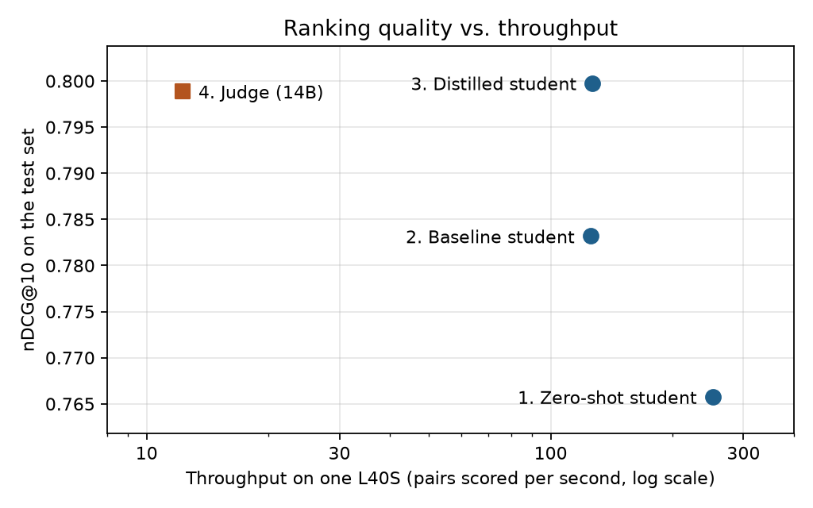

# Calibrate an LLM relevance judge on 5K labels, then distill it

**Question.** With a fixed budget of 5,000 human relevance labels for product search, which use of them gives the better small reranker?

- **(a) Baseline:** train a 0.6B reranker on the 5,000 labels directly.
- **(b) Method:** use the same labels to calibrate a 14B LLM judge, let the judge score 350K unlabeled query–product pairs, and train the same 0.6B reranker on the human labels plus the judge's scores.

**Answer.** (b). On 3,000 held-out test queries from Amazon's ESCI dataset, the distilled reranker beats the baseline by +0.017 nDCG@10 (95% CI +0.013 to +0.021) and matches the judge that taught it, at 10× the judge's throughput.

| Row | Model | Test nDCG@10 | Pairs/s | ms/query |
|---|---|---|---|---|
| 1 | Qwen3-Reranker-0.6B, zero-shot | 0.766 | 252 | 81 |
| 2 | Row 1 + 5K human labels (**baseline**) | 0.783 | 126 | 162 |
| 3 | Row 1 + 5K human labels + 350K judge labels (**method**) | **0.800** | 127 | 160 |
| 4 | Judge: Qwen3-14B, LoRA-tuned on the 5K labels | 0.799 | 12 | 1,658 |



Both arms use the same 5,005 labeled pairs, the same loss (Margin-MSE), the same LoRA setup and the same four learning rates, selected on a separate validation set. The test set was scored once per row. Throughput is measured on one L40S; rows 2 and 3 run with an unmerged LoRA adapter, which is why they are slower than row 1.

## What was done

1. **Data.** ESCI US Task 1, split by query: 5K labeled pairs, 1,000 validation queries, a 350K-pair pool used without its labels, 3,000 test queries.
2. **Baseline.** LoRA fine-tuning of the reranker on the 5K labels.
3. **Judge.** Qwen3-14B with LoRA, trained to output one of the four ESCI labels. Its relevance score is the expected gain under its label probabilities. Cohen's kappa against human labels rose from 0.26 (zero-shot) to 0.34.
4. **Gate.** The judge had to beat the baseline on validation with a bootstrap CI that excludes zero before any distillation. The first judge (Qwen3-8B) failed this gate and was replaced by the 14B model, which passed.
5. **Distillation.** The judge scored the pool (7.9 GPU-hours); the reranker was trained for one epoch on human labels plus judge scores.

Details, statistics, error analysis and all deviations from the plan are in [REPORT.md](REPORT.md).

## Limitations

- One draw of the 5,000 labels and one seed. The planned repeat at 50,000 labels was not run.
- The baseline does not use the unlabeled pool. Self-training without a judge is a stronger alternative that was not tested.
- Reranking of pre-selected candidates only, US English only.
- Human labels are noisy (91% agreement in the dataset authors' audit), and ESCI has been public since 2022, so the models may have seen it.
- For both arms the best learning rate was the lowest of the four tried.

## Reproduce

```bash
bash scripts/setup_gpu.sh                      # environment, data, tests
python scripts/make_splits.py                  # frozen splits (data/splits.json)
bash scripts/run_stage1.sh                     # rows 1-2
bash scripts/run_stage2.sh H5k Qwen/Qwen3-14B judge14b 16   # judge + pool labels
bash scripts/run_stage3.sh results/judge14b_h5k_U/scores_U.parquet   # row 3
python scripts/analyze.py --final              # tables, CIs, figure
```

Every reported number is generated by `scripts/analyze.py` from the raw score files in `results/` ([tables](results/tables.md), [summary.json](results/summary.json)).
